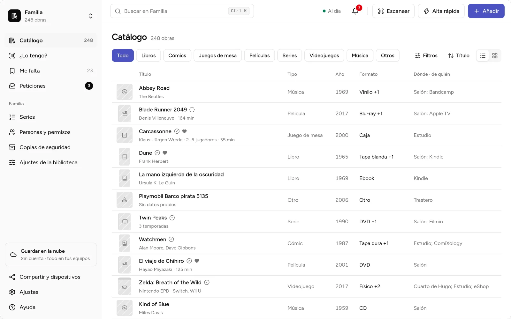
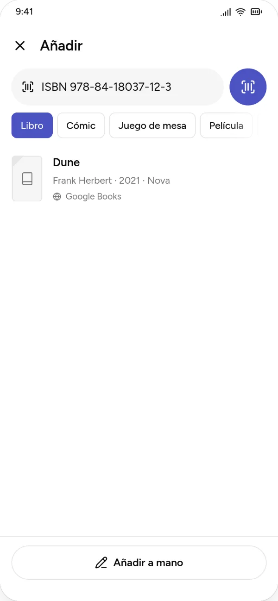

# Kosmotheka

**Everything your household owns, catalogued and shared.**

Kosmotheka is a free app to catalogue what a household owns: books first, then comics, board games, films, video games and anything else. Know what you have, where it is, whose it is and who has read it. The name comes from Greek *kosmos* (an ordered world) and *theka* (a store): the cosmos of your things.

- **Local-first.** The app works fully offline, with no account and no server. An account is optional.
- **Libraries you share, with roles.** Keep separate libraries (family, role-playing games, a child's video games), invite people and decide who can read and who can edit. Devices sync over your home network or through an optional server.
- **Scan to check.** In a shop, scan a barcode and find out whether you already own it.

  
  

## Download

- **Android:** in closed testing on Google Play; coming soon.
- **Windows and Linux:** coming soon.

The [downloads page](https://kosmotheka.com/en/download.html) on kosmotheka.com shows what is available.

## Documentation

A documentation site at docs.kosmotheka.com is coming soon, in three parts: using the app, running your own server and contributing. Until then, the working documents are in [`docs/`](docs/) (currently in Spanish).

## Run your own server

The server is optional and you can host it yourself. The official app can connect to any server. A guide will be part of the documentation site.

## Roadmap

What is planned, roughly in this order. There are no dates: it is a personal project, and each thing ships when it is ready.

**Now:** the public release. Closed testing on Google Play, the documentation site, and opening this repository.

**Next, once the app is live:**
- **Notifications on Android** with the app closed: a new request, a request accepted or declined, an invitation accepted.
- **Read a shelf from a photo, on the phone.** Take a picture of 15 to 20 spines, review what was read and add it. Nothing leaves the device.
- **Read a printed ISBN** with the camera, for when the barcode is covered by a shop label. Both come from a new open-source Tauri plugin for on-device text recognition.
- **Installers for Windows and Linux**, published with each release, and later the Snap Store and Flathub.

**Later:**
- **Loans:** what you lend and what you borrow, with history and reminders; the other person does not need the app.
- **Gift reservations**, hidden from whoever gets the gift.
- **Reading statistics** per year and per person, and **automatic backups**.
- **Shelf tools:** an inventory mode shelf by shelf, places inside places (living room › bookcase › shelf), printable QR labels, and importing from platforms such as Steam.
- **Optional AI** to read shelf photos and covers when the phone's reader is not enough, through your server's provider or your own key. Off unless you turn it on.

The full plan, with the reasons behind each decision, is in [`docs/ROADMAP.md`](docs/ROADMAP.md) (in Spanish for now). Ideas and requests are welcome as issues.

## Contributing

Bug reports, ideas and pull requests are welcome. Read [`CONTRIBUTING.md`](CONTRIBUTING.md) first. Please report security problems privately, as [`SECURITY.md`](SECURITY.md) explains. Everyone taking part follows the [Code of Conduct](CODE_OF_CONDUCT.md).

## Repository layout

Desktop and Android apps are built with [Tauri 2](https://tauri.app).

| Path | Contents |
|---|---|
| `app/` | Tauri app: React UI in `src/`, Rust core in `src-tauri/` |
| `crates/domain/` | Domain model, validation, hybrid logical clock and operations |
| `spec/` | Operation format: JSON Schema and conformance cases (MIT) |
| `server/` | Optional sync server: Symfony, PostgreSQL, with its own Docker setup |
| `web/` | The kosmotheka.com website |
| `site/` | The documentation site (docs.kosmotheka.com), built from Markdown with Starlight |
| `brand/` | Logo and brand files |
| `docs/` | Decisions, roadmap, architecture and development guides |

## License

- The app and the server are under the [AGPL-3.0-or-later](LICENSE).
- The operation format in `spec/` is under the MIT licence, so anyone can write a compatible client or server.
- **The name "Kosmotheka" and the logo are not covered by these licences.** See [`TRADEMARKS.md`](TRADEMARKS.md).

Third-party notices are in [`THIRD-PARTY-NOTICES.md`](THIRD-PARTY-NOTICES.md).
