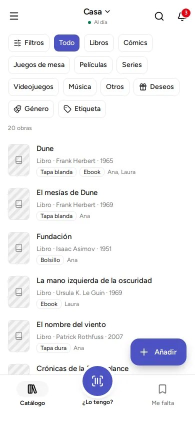

This page takes you from installing the app to your first book. It takes about five minutes.

## Install the app

- **Android:** the app is on Google's store (Google Play), but for now only a few people who are taking part in a trial can install it.
- **Computer, with Windows or Linux:** coming soon.

The [downloads page](https://kosmotheka.com/en/download.html) always shows what can be installed today.

### On Windows: the "Windows protected your PC" message

When you open the installer, Windows may show a blue window that says "Windows protected your PC" and that the app comes from an "unknown publisher". This is normal: it appears for programs that have not paid for a Microsoft certificate, and Kosmotheka, which is free, does not have one for now. It does not mean anything is wrong with the file.

To go on:

1. Click **"More info"**.
2. Check that the app is called `Kosmotheka-windows-x64-setup.exe`.
3. Click **"Run anyway"**.

Download the installer only from the downloads page on kosmotheka.com or from GitHub. If you want to check that the file is complete and is the one we published, every version comes with a `SHA256SUMS` file holding its fingerprint.

### On Linux

- **`.deb`** (Ubuntu, Debian, Linux Mint): the surest way is a terminal, in the folder you downloaded it to: `sudo apt install ./Kosmotheka-linux-amd64.deb`. Double-clicking depends on the version: on some (Ubuntu 22.04, for example) it opens the file without offering to install it. Without a terminal at hand, try right-click › "Open With" › "Software Install".
- **`.rpm`** (Fedora and similar): `sudo dnf install ./Kosmotheka-linux-x86_64.rpm`.
- **AppImage** (almost any Linux, nothing to install): allow it to run (in the file's properties, or `chmod +x Kosmotheka-linux-x86_64.AppImage`) and open it.

### Earlier versions

The downloads page always takes you to the latest version. If you need an earlier one, they are all in the [list of versions on GitHub](https://github.com/kosmotheka/kosmotheka/releases), each with its installers and what changed. On Android, Google Play only offers the latest.

## Open it for the first time

When you open it, a welcome appears with a few screens.

1. **Type your name.** The first screen asks "What is your name?". You cannot skip it. It is the name the people you share your libraries with will see. Your first library is created in your name, and you are its administrator: you can change everything in it. You can change your name later in "Settings", which is in the menu.
2. **Read the other screens.** They say that your library is on your phone or computer, how the barcode is scanned (on a phone only), which online services the details of books come from (you can turn each one on or off), and that you can share your library if you want. Tap "Next", or "Skip" if you are in a hurry.
3. **Tap "Get started".**

If you want to see the welcome again later, it is in "Help", with the button "See the welcome again".

## Add your first book

Your new library is empty. You will see the message "My library is empty" and a button, "Add the first one".

1. **Tap "Add".** On a phone it is the button at the bottom right. On a computer it is at the top right.
2. **Type the title,** for example "Dune". Results appear below as you type. You need an internet connection for this.
3. **Tap the result that is yours.** A page opens with the details already filled in.
4. **Check the details.** The only thing you must fill in is the title. Further down, under "Your copy" (each one you have of that book, on paper or digital), you can say what format it is, whose it is and where it is. The page [Copies, locations and whose each thing is](../copies-and-places/) explains it.
5. **Tap "Save".** You will see the message "“Dune” was added to the catalog", which means it is now in your library.

Tap the book in the list to see its full page.

## If there is no connection

Tap "Add manually" and fill in the details yourself. You can complete them later.

## What next

- [Add by scanning, by ISBN or by searching for a title](../add-a-book/): all the ways to add.
- [Share at home](../share-at-home/): so another phone or computer can see your library.
- [Backups](../backups/): so you do not lose anything.
