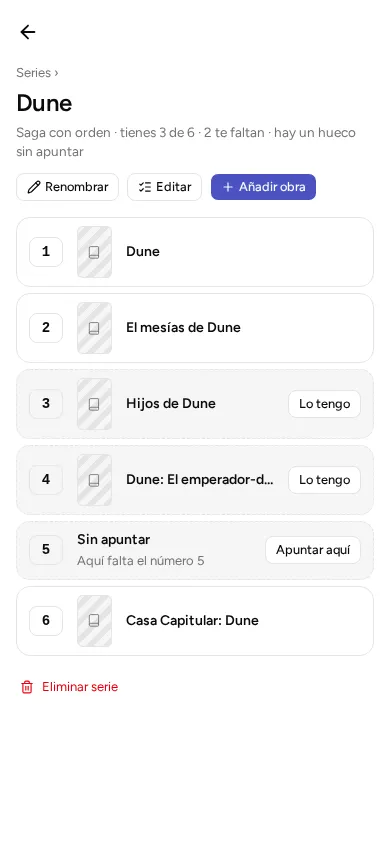

A **series** groups things that go together: the volumes of a saga, the games of one line. The app tells you how many you have. If the series has numbers, it also tells you which ones are missing.

A series on this page is not a TV series. TV series are another kind of thing, explained in [Books, comics, games, films, music](../kinds/). A series groups things of any kind.

The words *work*, *details* and *copy* are used here. They are explained in [Three words the app uses](../kinds/#three-words-the-app-uses).

## Two kinds of series

- **Ordered** ("Ordered saga"): a saga, with numbers 1, 2, 3… It is the only one that tells you which numbers you are missing. Those missing numbers are called **gaps**.
- **Unordered** ("Unordered line"): a line of products with no order, such as a game's expansions. It only groups them.

You choose the kind when you create the series. After that, the app does not let you change it.

Two series in the same library cannot have the same name.

## Create a series

1. In the menu, go to "Series".
2. Tap "New series".
3. Type the name.
4. Choose "Ordered" or "Unordered".
5. Tap the "New series" button at the bottom.

In the list, each series says how many things it has and how many you have ("you have 3 of 5"). As inside the series, the total counts the gaps of an ordered series.

Inside a series, "Rename" changes its name and "Delete series" deletes it. When you delete it, **the things stay in your catalog** (the list of everything you have noted). Only the grouping disappears.

## Put things in a series

There are two ways.

**From the series:**

1. Open the series and tap "Add a work".
2. Search for the thing in your catalog.
3. If the series is ordered, type the number that goes to it.

**From the thing:**

1. Open its details (its page).
2. Choose "Add to a series".
3. Choose the series and, if it is ordered, the number. You can also create a new series at that moment with "Create and add".

You can add anything from the catalog, whatever its kind, including the things you are missing.

## Gaps

In an ordered series, the app shows **every number from 1 up to the highest one** you have entered. A number with nothing noted for it is a gap. It shows as "Not logged", with the notice "Number 5 is missing here".

Tap **"Add one here"**. "Add" opens already on "Missing", with that number set. This way you note the volume you do not have yet. "Missing" is explained in [Your own: to read, reading, read, stars, favorites and "I want it"](../marks/).

Above the series there is a line that sums up your progress. For example: "Ordered saga · you have 3 of 6 · 2 missing · 1 gap not logged yet".

The total (here, 6) also counts the gaps. They are numbers the saga should have.

A gap and something "missing" are not the same:

- **A gap** is a number you have noted nothing for.
- **Something "missing"** is something you have noted, but of which you have no copies. It shows with a dotted border and an "I have it" button. Tapping it opens its details, so you can note the copy.

## Change numbers or remove things

Inside the series, tap "Edit".

- **In an ordered series**, type the number of each thing. You can leave gaps (1, 2, 5). Each number must be 1, 2, 3… with no decimals or letters.
- **In an unordered series**, "Edit" only serves to remove things.

With the × on each row, you take a thing out of the series. It stays in your catalog.

When you finish, tap "Done".
