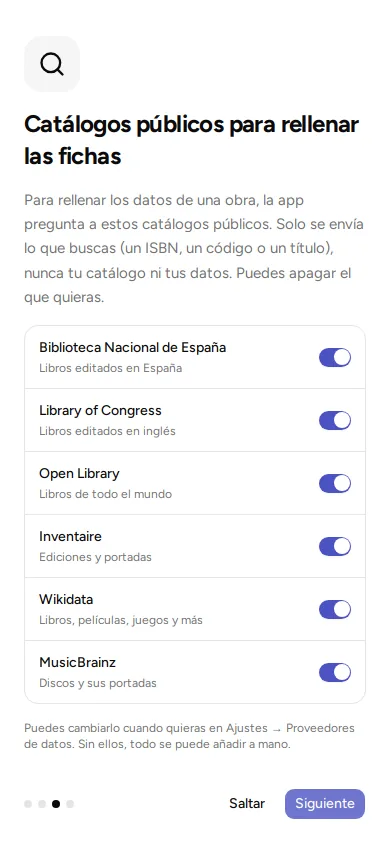

**Your books and everything else stay on your phone or computer.** Your notes, your stars, whose each thing is and your backups do not leave it on their own. Without an account, the app only uses the internet to look up the details of what you add and, on the computer, to know whether there is a new version.

## When you search for a book

When you search for a title or a code number, the app asks public online services, such as the catalog of the Spanish National Library. They only receive **what you search for**: the title you type, or the number of the code (for example, the ISBN). Never your list of books, your name or what you own.

With "Photo of a shelf", the app searches for you each text it read on the spines, one after another, as if you typed it. So those services also receive the texts that are not titles: the author's name, the publisher's or a misread spine. The photo does not leave your phone.

The search runs as you type, after a very short pause. Like any web page, each service sees which internet address you are asking from (the one at your home). It also sees that the question comes from Kosmotheka and from which version of the app.

These services are on from the start. Each one can be turned off.

| Service | What it is used for |
|---|---|
| Spanish National Library | Books published in Spain |
| Library of Congress | Books published in English |
| Open Library | Books from all over the world |
| Inventaire | Editions and covers |
| Wikidata | Books, films, games and more |
| MusicBrainz | Records and their covers |

Other services ask for a **key of your own**, free, which their website gives you so you can use their data. You get it yourself. They are Google Books (books), TMDB (films and series), RAWG (video games) and Comic Vine (comics). Until you put in your key, they are not used.

**Where to change it.** Go to "Settings", "Data providers". There you can see, for each kind of thing (books, films…), which services are used, turn them on or off, and put in your keys. If you turn them all off, you can add everything by hand.

## Covers

The cover image is downloaded from the service that has it and saved on your phone or computer. That service knows you asked for it. Your other devices get it from yours over your home Wi-Fi or, if the library is in the cloud, from your account's server, which keeps it with the library.

If you set a cover of your own (a photo or an image), it travels the same way: to your other devices and, if the library is in the cloud, to the server. Before keeping it, the app makes it smaller and removes the data a phone adds to a photo, such as where it was taken.

## The camera

The camera only turns on when you tap the scan button, "Photo of the number" to read the ISBN printed in a photo (when the barcode is a shop label) or "Photo of a shelf" to read the spines. Images are read on your own device: they are not saved or sent anywhere.

The scanner and the text reading are Google's (it is called ML Kit and comes with the phone's Google Play services). To know whether it works well, it sends Google technical data: the phone model, the system and app versions, and how long it takes or whether it fails. Never the images. None of that reaches us.

On Android, to read the barcode the app uses a piece of Google software that comes with the Google Play store. You can read its terms in the menu, under "About" and "Licences".

## Share at home

When you connect two devices to share (it is called pairing them, and it is explained in [Share at home](../share-at-home/)), the data goes **directly from one to the other, over your Wi-Fi**. It does not go through the internet or through any other computer. Only the libraries you tick are sent.

The people you share a library with see everything in it, including the names of the people and whose each thing is.

## Backups and spreadsheets

The files you create, you keep wherever you like. If you upload them to an online service (Google Drive, for example), that service's terms apply. The backup has a password; the spreadsheet list (CSV) does not. See [Backups](../backups/).

## New version notices (on the computer)

On the computer, the app tells you when a new version is out, with a link to the downloads page. To know, once a day, when you open it, it asks GitHub, where versions are published, which one is the latest. Nothing of yours is sent: GitHub sees the internet address you ask from and the app's version, like any website.

It is on from the start. You turn it off in the welcome or in "About", where you can also check for a new version by hand whenever you like. It does not exist on the phone: Google Play updates it. If you installed the app from the Snap Store, neither: the store updates it by itself.

## If you create an account

The account is optional. If you create one and upload a library, that library also lives on a computer on the internet (your account's server) that keeps it for you. Also, searches in some services can go through that computer. When you sign in, a screen tells you which ones, what is sent to each one, and lets you turn them off; it shows again if your server adds a new one or you move to another server. What it keeps, for how long and how to delete it is in [the privacy page](https://kosmotheka.com/en/privacy.html).

## What the app does not do

- It has no ads.
- It does not measure how you use it or follow you.
- It does not sell or hand over data.
- It does not ask for any personal data to work without an account, apart from the name you type at the start. That name stays on your device and on those of the people you share with.

## Deleting your data

- **Deleting a library** (in "Library settings", "Delete library") removes it from this device **and from all the ones that share it**. It cannot be undone. Before deleting, the app offers to save a backup. If you only want to remove it from this device and let the others keep it, use "Remove from this device".
- **"Reset this device"**, in "Settings", leaves the device as it was when the app was first installed.
- **Uninstalling the app** also removes its data from the device.
- The backups you have made stay where you saved them.

If you have any questions: privacy@kosmotheka.com.
