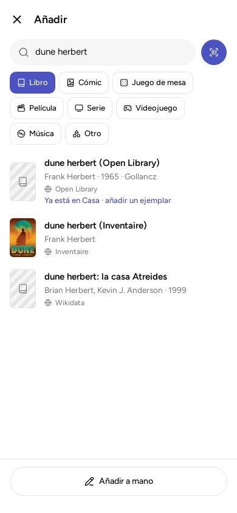

Hay tres formas de añadir algo: escanear su código de barras, escribir su número o buscarlo por título. En las tres empiezas igual: pulsa «Añadir».

La app no lleva guardados los datos de los libros: los busca por ti en servicios de internet, como el catálogo de la Biblioteca Nacional. Para eso necesitas conexión.

El ISBN es el número que lleva cada libro, junto al código de barras. Empieza por 978 o 979.

## Escaneando el código de barras

Solo en el móvil.

1. Pulsa «Añadir» y después el botón de la cámara, a la derecha del cuadro de búsqueda.
2. Si el móvil pide permiso para usar la cámara, acéptalo.
3. Pon la cámara delante del código de barras del libro. En los libros, es el que empieza por 978 o 979.

Si la tienda ha puesto una pegatina encima del código de barras, la app leerá la pegatina y no encontrará nada. Apunta al código del propio libro. Si no se deja leer, tienes dos botones abajo, en la pantalla de la cámara:

- **«Foto del número»** abre la cámara de tu móvil. Haz una foto de la contraportada donde se vea el ISBN impreso («ISBN 978-…» o el número bajo el código de barras) y acéptala: la app lee el número en la foto, en tu móvil, sin enviarla a ningún sitio, y lo busca. Funciona mejor de cerca, con buena luz y sin que la foto salga movida. Si encuentra varios ISBN (el de otra edición, el del libro electrónico), te pregunta cuál es el tuyo; si no encuentra ninguno, te lo dice y puedes escribirlo.
- **«Escribir el número»** te deja escribir el número pequeño que va debajo del código, con el teclado numérico.

Con la cruz de arriba a la izquierda cierras la cámara.

Para leer el código o el número con la cámara necesitas un móvil Android con la tienda de Google (Google Play). Si no lo tienes, escribe el número a mano. En el ordenador no hay cámara ni «Foto del número».

## Escribiendo el número

En el ordenador no se escanea con cámara. Escribe o pega el número en el cuadro de búsqueda. Si tienes un lector de códigos de barras que se conecta al ordenador, también sirve, pero no es necesario.

- Escribe el número tal como está impreso, con guiones o sin ellos. La app lo reconoce cuando está completo y cambia la lupa por un código de barras pequeño.
- Los libros antiguos tienen un ISBN más corto, de 10 cifras, que a veces acaba en una X. También vale. Solo una cosa: si llegas aquí con «Escribir el número» desde la cámara, el teclado es solo de números y no tiene la X. Para esos libros, usa «Foto del número», o escríbelo en «¿Lo tengo?» o en el cuadro de búsqueda sin pasar por la cámara.
- Si el código no dice de qué tipo es (una película, un juego, un disco…), la app te pide que elijas el tipo y lo busca ahí.

## Buscando por título

1. Elige el tipo de lo que buscas: Libro, Cómic, Juego de mesa, Película, Serie, Videojuego, Música u Otro. Ya viene marcado «Libro».
2. Escribe el título, de dos letras en adelante. Los resultados salen mientras escribes.
3. Cada resultado dice de qué servicio de internet viene. Toca el que sea el tuyo. Con los libros, salen primero los que se llaman justo así y están en el idioma de la app, y las ediciones de una misma obra van juntas.

Con «Otro» no se busca en ningún sitio: se añade a mano.

## Cuando aparece lo que buscabas

Se abre la ficha con los datos rellenados. **Revísalos antes de guardar:** los servicios de internet a veces se equivocan o dejan huecos. Cámbialo todo lo que haga falta y pulsa «Guardar».

**La portada:** si no trae ninguna o no es la de tu edición, toca la portada en la ficha. En el móvil puedes «Hacer una foto» o «Elegir una imagen»; en el ordenador, elegir una imagen. Y con «Buscar en los catálogos» la app busca otra vez con el ISBN, el título y la autoría que tiene la ficha en ese momento: sirve si los has añadido o corregido. Tocas la que sea y se guarda con la ficha. Se guarda reducida y sin los datos que añade el móvil a la foto (como el lugar donde se hizo), y pasa a tus otros dispositivos como cualquier portada: por la wifi de casa o, si la biblioteca está en la nube, a través del servidor de tu cuenta. Lo mismo vale al editar una obra que ya tienes.

Si el resultado dice «Ya está en Mi biblioteca», ya lo tienes. Al tocarlo se abre su ficha, y desde ahí puedes añadir otro ejemplar (otro que tengas de él, en papel o en digital).

## Cuando no aparece

- Si no hay conexión, o los servicios de internet no lo conocen, pulsa «Añadir a mano». Puedes completar la ficha más tarde.
- Para cómics, juegos de mesa, películas, series y videojuegos, sin cuenta y sin una contraseña propia de esos servicios, la búsqueda solo se hace en Wikidata (una enciclopedia abierta de datos), y la de música solo en MusicBrainz (una base de datos abierta de discos). A veces faltan portadas o ediciones. La app lo avisa con un mensaje debajo del cuadro de búsqueda.
- Hay servicios que piden una contraseña propia, gratuita, que te da su web para dejarte usar sus datos. Google Books, por ejemplo, da mejores resultados con ella. Se pone en «Ajustes», «Proveedores de datos». Está explicado en [Qué sale de tu dispositivo y qué no](../what-leaves-your-device/).

## Añadir muchos de golpe

En el ordenador, el botón «Alta rápida» (arriba, junto a «Añadir») sirve para meter muchos números uno tras otro. Cada libro encontrado se guarda al momento con los datos del ejemplar que hayas puesto debajo (formato, de quién es, dónde está). Al final dice cuántos se han añadido, cuántos ya estaban y cuántos hay que revisar.

Si ya tienes tu lista en una hoja de cálculo, mira [Copias de seguridad, exportar e importar](../backups/).

## Una balda entera de golpe

Para la primera carga de tu biblioteca, en un móvil Android. En el ordenador no se pueden leer los lomos: empareja un móvil y hazlo desde él, que lo que añadas allí llega solo al ordenador. En «Añadir», antes de buscar nada, pulsa **«Foto de una balda»**. No sale al apuntar en «Me falta», ni donde solo puedes consultar, porque añade directamente.

1. Elige qué hay en la balda: libros, cómics, películas… Viene marcado lo que tenías elegido en «Añadir».
2. Pulsa «Hacer la foto», o «Elegir una foto» si ya la tienes en el móvil. Fotografía **una sola balda**, de frente y de cerca, con buena luz. Salen mejor entre 15 y 20 lomos por foto.
3. La app lee los lomos en tu móvil y busca cada texto en los catálogos. Verás cómo avanza y lo que va encontrando.
4. Te enseña **solo lo que encuentra** como una obra de verdad, ya marcado. Lo que ya tienes sale sin marcar: si lo marcas, se añade otro ejemplar.
5. Pon el propietario, el formato y la ubicación, que valen para todas, y pulsa «Añadir».

**No lo leerá todo.** Lee bien los lomos con letra normal; los de letra estrecha, adornada o muy pequeña, y los que están en bolsas o con brillos, se le escapan. Lo que no encuentra queda en «textos sin encontrar»: unos son el autor o la editorial, otros un título mal leído. Toca uno para buscarlo tú. Lo que falte, lo añades como siempre.

La foto no sale de tu móvil, pero los textos leídos se buscan en los catálogos, como si los escribieras tú (más en [Qué sale de tu dispositivo](../what-leaves-your-device/)).

## Si en una biblioteca solo puedes consultar

En una biblioteca compartida donde solo puedes consultar (eres «lector»), en vez de «Añadir» verás «Pedir que se añada». Quien administra la biblioteca decide si lo acepta.
