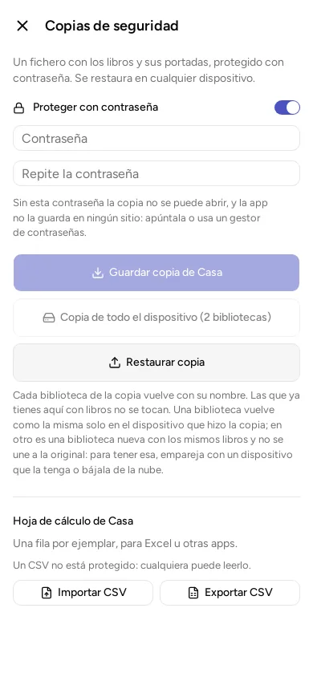

Tus bibliotecas viven en tu dispositivo. Si lo pierdes, se rompe o lo borras sin querer, solo recuperas lo que tengas en una copia de seguridad. Conviene hacerlas de vez en cuando.

Todo esto está en el menú, en «Copias de seguridad».

## Guardar una copia

Una copia es un fichero con tus libros y sus portadas.

1. Abre «Copias de seguridad».
2. Deja activado «Proteger con contraseña». Viene así de entrada.
3. Escribe una contraseña de al menos 8 caracteres y repítela.
4. Pulsa «Guardar copia de» y el nombre de tu biblioteca.
5. Elige dónde guardar el fichero: una carpeta, un pendrive o tu espacio de Google Drive, por ejemplo.

Al terminar, la app dice cuántos libros, ejemplares y portadas ha guardado.

**Apunta la contraseña.** Sin ella nadie puede abrir la copia, y la app no la guarda en ningún sitio. Una app que guarde tus contraseñas es un buen sitio.

Puedes quitar la contraseña apagando el interruptor. Entonces la app avisa de que quien encuentre el fichero podrá leerlo: nombres, lo que tenéis y quién tiene qué.

## Copiar todo el dispositivo

Si tienes más de una biblioteca, el botón «Copia de todo el dispositivo» las guarda todas en un solo fichero.

## Recuperar una copia

1. Abre «Copias de seguridad» y pulsa «Restaurar copia».
2. Elige el fichero.
3. Si está protegido, escribe su contraseña y pulsa «Desbloquear y restaurar». Si te equivocas, no se restaura nada y puedes volver a intentarlo.

Cada biblioteca de la copia vuelve con su nombre. Las que ya tienes en el dispositivo con libros no se tocan.

**Una cosa que conviene saber.** Si restauras en el mismo dispositivo que hizo la copia, la biblioteca vuelve como la misma. Si restauras en otro dispositivo, vuelve como una biblioteca nueva con los mismos libros, y **no se une a la original**. Para recuperar la biblioteca original en un dispositivo nuevo, empareja con otro dispositivo que la tenga ([Compartir en casa](../share-at-home/)) o bájala de tu cuenta, si usas una.

Si la app dice que la copia es de otra versión, actualiza la app y vuelve a intentarlo.

## Tu lista en una hoja de cálculo

En la misma pantalla, el apartado «Hoja de cálculo» te deja pasar la biblioteca a Excel, LibreOffice u otra app, o traer una lista que ya tengas.

### Exportar

Pulsa «Exportar CSV» y elige dónde guardar. Un CSV es un fichero de texto con una fila por ejemplar. La app dice cuántas filas ha escrito.

El CSV **no está protegido**: cualquiera que lo encuentre puede leerlo. Tampoco lleva todo: no trae el tipo, las portadas, las series, tus marcas (leído, estrellas…) ni los datos propios de cada tipo.

### Importar

Pulsa «Importar CSV» y elige el fichero. La primera fila tiene que ser los nombres de las columnas, escritos así:

| Columna | Qué lleva |
|---|---|
| `title` | El título. **Es lo único obligatorio.** |
| `subtitle` | El subtítulo |
| `authors` | La autoría. Si hay varias personas, sepáralas con punto y coma: `Margaret Weis; Tracy Hickman` |
| `publisher` | La editorial |
| `published_year` | El año, con cifras |
| `language` | El idioma, con su código de dos letras: `es` para español, `en` para inglés… |
| `isbn13` | El ISBN |
| `format` | El formato, con una de las palabras de la tabla de abajo |
| `owner` | De quién es |
| `quantity` | Cuántas unidades. Si no pones nada, una |
| `location` | Dónde está |
| `acquired_on` | La fecha de compra, como `2026-10-16` |

En la columna `format` hay que usar estas palabras en inglés, tal cual:

| En la app | En el CSV |
|---|---|
| Tapa dura | `hardcover` |
| Tapa blanda | `paperback` |
| Bolsillo | `pocket` |
| Ebook | `ebook` |
| PDF | `pdf` |
| Audiolibro | `audiobook` |
| Otro, o sin formato | `other`, o vacío |

(La app también acepta `single_issue`, `box`, `dvd`, `bluray`, `uhd`, `physical`, `digital`, `vinyl`, `cd` y `cassette`, pero la importación apunta todo como libro.)

Cosas que pasan al importar:

- Todo entra como libro.
- Si el ISBN de una fila ya está en tu catálogo, no se duplica el libro: se le añade un ejemplar.
- Las filas con errores se saltan y el resto se importa. Al terminar, la app dice cuántos libros nuevos hay, cuántos ejemplares se han añadido a libros que ya tenías y cuántas filas se han rechazado, con la línea de cada una.
- Si la app no entiende una columna, la ignora.

Puedes probarlo con una biblioteca nueva, para ver cómo queda antes de mezclarlo con la tuya.
