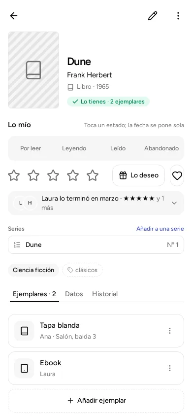
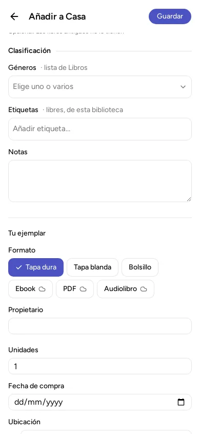

Un mismo libro puede estar en casa más de una vez: en papel, en ebook, uno de cada persona. Cada uno de los que tienes es un **ejemplar**. Un ejemplar dice en qué formato lo tienes, de quién es y dónde está.

Dune, por ejemplo, puede tener dos ejemplares: uno en tapa blanda que es de Ana y está en el salón, y otro en ebook que es de Laura.

## Qué lleva un ejemplar

- **Formato.** Depende del tipo:
  - Libro: Tapa dura, Tapa blanda, Bolsillo, Ebook, PDF, Audiolibro.
  - Cómic: Tapa dura, Tapa blanda, Grapa, Digital.
  - Juego de mesa: Caja, Digital.
  - Película: DVD, Blu-ray, 4K, Digital.
  - Serie: DVD, Blu-ray, Digital.
  - Videojuego: Físico, Digital. Además se pide la plataforma, que es la consola o el ordenador en el que se juega.
  - Música: Vinilo, CD, Casete, Digital.
  - Otro: solo «Otro».
- **Propietario.** De quién es. Empieza a escribir un nombre y la app te sugiere los de las personas de la biblioteca. Si lo dejas vacío, el ejemplar queda «Sin propietario».
- **Unidades.** Cuántos iguales tienes juntos. Todas las unidades de un ejemplar comparten formato, dueño, ubicación y fecha de compra. Si tienes tres iguales en el salón, pon 3 en un solo ejemplar. Si uno está en otro sitio, es de otra persona o es de otro formato, apúntalo en un ejemplar aparte. Cuando un ejemplar tiene más de una unidad, la ficha lo dice («3 unidades»), y el «Lo tienes · 3 ejemplares» de arriba cuenta las unidades.
- **Fecha de compra.** Opcional.
- **Ubicación.** Dónde está, con las palabras que quieras: «Salón, estantería 2, balda 3». La app te sugiere las ubicaciones que ya has usado, para que no te salgan escritas de tres maneras distintas. Con los formatos digitales (ebook, PDF, audiolibro, películas o juegos en internet…) no hay estantería: di dónde lo tienes, por ejemplo «Kindle de Laura».

Solo el título es obligatorio. Todo lo demás puede quedarse vacío y completarse más tarde.

## Apuntar un ejemplar al añadir algo

Al añadir un libro, la ficha termina con una sección «Tu ejemplar». Se rellena ahí mismo, antes de pulsar «Guardar».

## Añadir otro ejemplar a algo que ya tienes

1. Toca el libro en tu lista para abrir su ficha.
2. Abre la sección «Ejemplares».
3. Pulsa «Añadir ejemplar».
4. Rellena el formato, el propietario, las unidades y la ubicación, y guarda.

## Cambiar o borrar un ejemplar

En la sección «Ejemplares», toca un ejemplar para cambiarlo: se abre su formulario. Para borrarlo, la papelera que tiene al lado; si no puedes borrarlo tú (es de otra persona, o solo puedes pedir cambios), la papelera pide que lo borre quien administra.

Si borras un ejemplar, el libro **sigue en tu biblioteca**: solo desaparece ese ejemplar. Para quitar el libro entero, usa «Borrar» en el menú de su ficha: se van el libro y todos sus ejemplares.

Lo que borras pasa a la **papelera** de la biblioteca, donde se queda 30 días por si te arrepientes. Justo después, el aviso de abajo tiene «Deshacer». Está en [La papelera](../trash/).

## Algo que quieres y no tienes

Lo que apuntas sin ningún ejemplar (desde «Me falta», con el botón «Apuntar» en el móvil o «Añadir» en el ordenador, o porque has borrado todos sus ejemplares) queda en la lista «Me falta». Cuando lo consigas, abre su ficha y pulsa «Lo tengo»: añade un ejemplar y deja de faltar.

## Las personas de la biblioteca

Los propietarios son las personas de la biblioteca (cada una con su nombre). Si escribes un nombre que todavía no existe, la app lo apunta como una persona nueva. La verás en «Personas y permisos», que está en el menú. Que una persona sea la dueña de un ejemplar no le da permiso para cambiar la biblioteca: eso se explica en [Compartir en casa](../share-at-home/).
