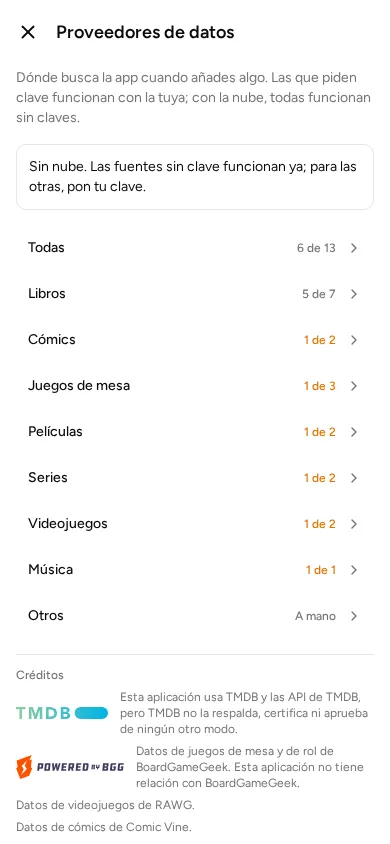

La app no lleva guardados los datos de los libros, las películas o los juegos. Cuando añades algo, **los busca por ti** en servicios de internet. Son bases de datos públicas, como el catálogo de la Biblioteca Nacional de España.

Esta página explica cuáles son, qué les envía la app y cómo elegir cuáles usar. Para ver todo lo que sale de tu dispositivo, mira [Qué sale de tu dispositivo y qué no](../what-leaves-your-device/).

Si prefieres no usar ninguno, apágalos todos. Todo se puede añadir a mano.

## Dónde se cambia

1. Abre el menú y entra en «Ajustes».
2. Pulsa «Proveedores de datos».
3. A la izquierda, elige «Todas» o un tipo (libros, cómics, películas…).

Verás los servicios que se usan para ese tipo.

Cada tipo muestra un número como «2 de 5». Quiere decir que 2 de sus 5 servicios se pueden usar ahora. Si son pocos, el número sale en naranja: la app buscará en pocos sitios.

«Otro» no busca en ningún sitio: se añade a mano.

## Qué quiere decir cada etiqueta

Cada servicio tiene un **interruptor** para encenderlo o apagarlo. Debajo lleva una etiqueta que dice qué necesita:

- **«Sin clave»**: funciona ya, sin hacer nada. Vienen encendidos.
- **«Pide clave»**: necesita una clave tuya. Una **clave** es como una contraseña: la web del servicio te la da gratis para que uses sus datos. Hasta que la pongas, ese servicio no se usa.
- **«Pide cuenta»**: solo funciona si tienes una cuenta de Kosmotheka. Se explica [más abajo](#si-tienes-cuenta-algunos-van-por-el-servidor).
- **«Pide clave o cuenta»**: vale una clave tuya o una cuenta.

## Qué servicios hay para cada tipo

| Tipo | Servicio | Qué es | Qué necesita |
|---|---|---|---|
| Libro | Biblioteca Nacional de España, Library of Congress (la biblioteca de Estados Unidos), Open Library, Inventaire | Catálogos de libros | Nada |
| Libro | Wikidata | Una enciclopedia gratuita que cualquiera puede consultar | Nada |
| Libro | Google Books | El buscador de libros de Google; el más completo por ISBN | Clave propia, o cuenta |
| Libro | RPGGeek | Una web de libros de rol; solo busca por título | Cuenta |
| Cómic | Wikidata | Como arriba | Nada |
| Cómic | Comic Vine | Una web de cómics | Clave propia, o cuenta |
| Juego de mesa | Wikidata | Como arriba | Nada |
| Juego de mesa | GameUPC | Dice qué juego es el código de barras de la caja | Cuenta |
| Juego de mesa | BoardGameGeek | Una web de juegos de mesa | Cuenta |
| Película y serie | Wikidata | Como arriba | Nada |
| Película y serie | TMDB | Una web de películas y series | Clave propia, o cuenta |
| Videojuego | Wikidata | Como arriba | Nada |
| Videojuego | RAWG | Una web de videojuegos | Clave propia, o cuenta |
| Música | MusicBrainz | Una base de datos abierta de discos | Nada |

El **ISBN** es el número que va junto al código de barras de un libro.

Las portadas se bajan del servicio que las tiene y se guardan en tu dispositivo.

Sin clave ni cuenta, los cómics, los juegos de mesa, las películas, las series y los videojuegos se buscan solo en Wikidata. Funciona, pero a veces faltan portadas o ediciones. Por eso la app te avisa.

## Poner una clave propia

1. En «Proveedores de datos», abre el servicio que pide clave.
2. Pulsa «Cómo conseguir una clave» y sigue los pasos de su web.
3. Pega la clave en «Pega aquí tu clave».
4. Pulsa «Guardar».
5. Pulsa «Probar». La app te dice «La clave funciona.» o «Esta clave se ha rechazado.».

En TMDB hay dos claves. Pega la larga, la que lleva el nombre «API Read Access Token». No pegues la clave corta.

Con la clave puesta, la app pregunta **directamente** al servicio. Los datos no pasan por ningún ordenador de Kosmotheka. La app lo dice así: «Usa tu propia clave».

Para quitar la clave, pulsa «Quitar la clave de…» y el nombre del servicio.

## Apagar un servicio

Pulsa el interruptor del servicio. Deja de recibir preguntas y no sale en los resultados.

Si habías puesto una clave, se queda guardada por si lo vuelves a encender.

## Qué se envía a cada servicio

Se envía solo **lo que buscas**. Es el título que escribes o el número del código de barras (por ejemplo, el ISBN).

No se envía tu lista de libros, ni tu nombre, ni lo que tienes.

Como cualquier página web, cada servicio ve desde qué conexión de internet le preguntas. Ve también que la pregunta viene de Kosmotheka y qué versión de la app la hace.

## Si tienes cuenta: algunos van por el servidor

Con una cuenta de Kosmotheka, algunos servicios se consultan a través del **servidor** de tu cuenta. El servidor es el ordenador, en internet, que guarda las bibliotecas de la nube. La **nube** es tener tus bibliotecas también en internet, en tu cuenta. Está explicada en [La nube](../the-cloud/).

El servidor busca con su propia clave. Por eso **no necesitas poner la tuya**.

Los servicios que se pueden consultar así son Google Books, TMDB, RAWG, Comic Vine, BoardGameGeek, RPGGeek y GameUPC. Solo funciona si tu servidor los ofrece.

Qué pasa cuando buscas por el servidor:

1. La app envía a tu servidor lo que escribes. Según el servicio, envía también si es película o serie, o el idioma de la app.
2. Lo envía con un permiso que te da la app al entrar con tu cuenta. Así el servidor sabe que tienes cuenta.
3. El servicio de internet cree que la pregunta la hace Kosmotheka, no tú.
4. El servidor guarda la respuesta unos días, para no repetir la pregunta. **No guarda quién la pidió ni el texto que escribiste.**

Para que una búsqueda no pase por el servidor, tienes dos caminos:

- pon tu propia clave, que tiene preferencia; o
- apaga ese servicio.

Google Books tiene además su propio interruptor, «Buscar en Google Books a través de la nube», que viene encendido. Con él apagado, la app pregunta a Google Books directamente.

BoardGameGeek, RPGGeek y GameUPC no admiten clave propia. Sin cuenta, esos tres no se usan.

**GameUPC aprende de lo que eliges.** A veces no está seguro de qué juego es un código: entonces te propone varios, o ninguno, y eliges el tuyo o lo buscas por su nombre. Al guardarlo, la app le dice a GameUPC, a través del servidor, qué juego era, para que la próxima vez lo sepa. Le llega el código, el número del juego en BoardGameGeek y un identificador de tu cuenta que no dice quién eres: GameUPC lo pide para poder deshacer lo que mande alguien de mala fe.

Los detalles (qué guarda el servidor y cuánto tiempo) están en la [política de privacidad](https://kosmotheka.com/es/privacidad.html).

## Créditos

TMDB, RAWG, Comic Vine y BoardGameGeek tienen su aviso en la propia pantalla, en «Créditos».

Esta aplicación usa los datos de TMDB y de BoardGameGeek, pero no tiene nada que ver con ellos ni la hacen ellos.
