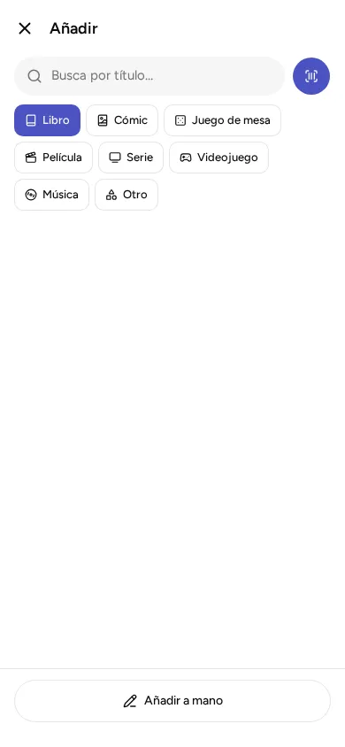

Cada cosa que apuntas es de un **tipo**, y según el tipo la ficha te pide unos datos u otros. Un juego de mesa lleva jugadores y duración; una serie, sus temporadas; un libro, su autoría y su ISBN.

Los tipos son ocho: **Libro, Cómic, Juego de mesa, Película, Serie, Videojuego, Música y Otro**. La lista no se puede cambiar ni ampliar. Para lo que no encaje en ninguno (maquetas, puzles, juguetes…) está «Otro».

## Elegir el tipo

- Al añadir **buscando por título**, eliges el tipo antes de escribir. Ya viene marcado «Libro». Está explicado en [Añadir escaneando, por ISBN o buscando por título](../add-a-book/).
- Al **añadir a mano**, la primera pregunta es «¿Qué es?». Si cambias de tipo mientras rellenas la ficha, lo que ya has escrito se queda.
- En el catálogo, la fila de botones de arriba («Todo», «Libros», «Cómics»…) enseña solo un tipo. La portada de lo que no tiene imagen tiene la forma de su tipo: alta para un libro, cuadrada para un juego de mesa o un disco, de caja para una película.

## Qué datos lleva cada tipo

Todos llevan título, año, portada, notas, géneros y etiquetas. Además:

| Tipo | Datos propios | Formatos de sus ejemplares |
|---|---|---|
| Libro | Autoría, subtítulo, editorial, idioma, ISBN | Tapa dura, Tapa blanda, Bolsillo, Ebook, PDF, Audiolibro |
| Cómic | Guion, dibujo, editorial, número, código de barras | Tapa dura, Tapa blanda, Grapa, Digital |
| Juego de mesa | Diseño, editorial, jugadores (de cuántos a cuántos), duración, edad mínima, código de barras | Caja, Digital |
| Película | Dirección, duración, código de barras | DVD, Blu-ray, 4K, Digital |
| Serie | Temporadas, código de barras | DVD, Blu-ray, Digital |
| Videojuego | Estudio, código de barras | Físico, Digital |
| Música | Artista, sello, código de barras | Vinilo, CD, Casete, Digital |
| Otro | Código de barras (opcional) y las notas | Otro |

Solo el título es obligatorio. Lo demás puede quedarse vacío.

Tres detalles que cambian de un tipo a otro:

- **Videojuegos:** la plataforma (Switch, PS5, PS4, Xbox Series, PC, u otra que escribas) no va en la ficha del juego, sino en **cada ejemplar**, porque el mismo juego puede estar en dos consolas.
- **Series:** cada ejemplar dice «Qué temporadas» tienes. Si las tienes todas, se deja vacío.
- **Otro:** no tiene datos propios. Lo que quieras apuntar (fabricante, referencia, estado…) va en las notas.

La ficha de un ejemplar (formato, dueño, ubicación, unidades) se explica en [Ejemplares, ubicaciones y de quién es cada cosa](../copies-and-places/).

## Lo digital no tiene estantería

Son digitales los formatos Ebook, PDF, Audiolibro y «Digital». Un ejemplar digital no está en una balda: en vez de una ubicación, la app te pide **dónde lo tienes** y te sugiere servicios según el tipo, como Kindle, Steam o Filmin. Puedes escribir el que quieras.

## Los géneros de cada tipo

Los géneros son una **lista cerrada** que trae la app, distinta para cada tipo. En una ficha eliges uno o varios.

- Libro: Novela, Ciencia ficción, Fantasía, Terror, Misterio y policiaca, Histórica, Romántica, Poesía, Teatro, Ensayo, Biografía y memorias, Divulgación, Infantil, Juvenil, Rol, Cocina, Arte y fotografía, Viajes y otros.
- Cómic: Superhéroes, Manga, Humor, Novela gráfica, Policiaco, Histórico, Infantil y otros.
- Juego de mesa: Estrategia, Familiar, Party, Cooperativo, Abstracto, Cartas, Colocación de losetas, Colocación de trabajadores, Construcción de mazos, Deducción, Wargame, Infantil, Rol y otros.
- Película y serie: Acción, Aventuras, Animación, Comedia, Documental, Drama, Musical, Suspense, Bélica, Western y más.
- Videojuego: Acción, Aventura, Rol, Estrategia, Plataformas, Puzles, Carreras, Deportes, Lucha, Disparos, Simulación y más.
- Música: Rock, Pop, Jazz, Clásica, Electrónica, Hip hop, Folk, Flamenco, Blues, Soul y funk, Metal, Bandas sonoras y más.
- Otro: no tiene géneros.

Si necesitas algo que no está en la lista, usa una **etiqueta**: son palabras libres que escribes tú en una obra («para viajes», «regalo»). Las ves y las renombras en «Ajustes de la biblioteca», «Etiquetas». Tanto un género como una etiqueta sirven para filtrar el catálogo: toca el género o la etiqueta en la ficha, o usa los botones «Género» y «Etiqueta» de arriba.

## Cambiar una cosa de tipo

Si te equivocaste, abre la ficha, pulsa «Editar» y cambia el «Tipo». Antes de cambiar nada, la app te dice qué datos pasan al tipo nuevo (por ejemplo, la autoría de un libro pasa a guion en un cómic) y cuáles se pierden. Título, año, portada y notas no cambian. Si un ejemplar tenía un formato que el tipo nuevo no tiene (un «Bolsillo» en un cómic), te pide que elijas otro. Hasta que confirmas, no se cambia nada; también puedes pulsar «Dejarlo como…».

## Cuando una cosa necesita otra

Una expansión no sirve sin su juego base. En «Editar», el campo «Necesita» te deja apuntar la otra obra. Si la necesita y no la tienes, la ficha te avisa («Necesita… que no tienes») y la ficha del juego base dice «Lo necesitan». Se puede usar en cualquier tipo.
