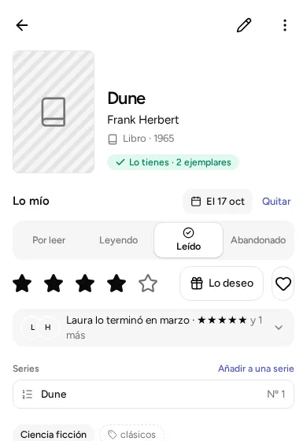

Dos personas de casa pueden tener opiniones distintas sobre el mismo libro: Ana lo ha leído y le ha encantado, Hugo lo tiene pendiente. Por eso lo que apuntas sobre un libro, una película o cualquier cosa (si la has leído, cuántas estrellas le das, si es tu favorita) es **solo tuyo**. Si no recuerdas qué es una obra, una ficha o un ejemplar, mira [Tres palabras de la app](../kinds/#tres-palabras-de-la-app). No cambia lo que apuntan los demás.

## Dónde se apunta

Abre la ficha de cualquier cosa (su página). Verás una parte llamada **«Lo mío»** con:

- **Tu estado.** Toca uno y se pone la fecha de hoy. Para cambiarla, toca la fecha. Si tocas el mismo estado otra vez, se quita.
- **«Quitar»**, un botón que aparece cuando has marcado un estado. Borra todo lo tuyo de esa obra.
- **Tus estrellas**, de 1 a 5. Si tocas otra vez la misma estrella, se quita.
- **«Favorito»**, el corazón.
- **«Lo deseo»**, el regalo. Más abajo se explica.

Todo esto lo puede hacer cualquier persona de la biblioteca, sea administradora, editora o lectora: no cambia la biblioteca, solo lo tuyo.

Hace falta una cosa: que alguien le haya dicho a la app de quién es este móvil o este ordenador. Si no, «Lo mío» aparece desactivada y te avisa de que alguien que administra la biblioteca (puede cambiarlo todo) tiene que decirlo antes. Se explica en [Compartir en casa](../share-at-home/).

## Los estados cambian con el tipo

Son cuatro, y se llaman distinto según lo que sea:

| Tipo | Estados |
|---|---|
| Libro, cómic | Por leer · Leyendo · Leído · Abandonado |
| Juego de mesa | Por jugar · Jugando · Jugado · Abandonado |
| Videojuego | Por jugar · Jugando · Terminado · Abandonado |
| Película, serie | Por ver · Viendo · Vista · Abandonada |
| Música | Por escuchar · Escuchando · Escuchado · Abandonado |
| Otro | Pendiente · Empezado · Terminado · Abandonado |

Los nombres de la tabla salen cuando ves la ficha de una cosa, o la lista de un solo tipo. En una lista que mezcla tipos (el catálogo con «Todo» marcado, por ejemplo) salen los nombres generales: **Pendiente, En curso, Terminado y Abandonado**. «Empezado» es solo el nombre de «En curso» para el tipo «Otro».

## Lo de los demás

Debajo de «Lo mío», la ficha enseña lo que han apuntado las otras personas de la biblioteca: su estado, sus estrellas y su corazón. Si son varias, se ven las primeras y «y 2 más» abre el resto. Recuerda que quien comparte una biblioteca con otras personas ve lo que ellas apuntan, igual que ellas ven lo tuyo.

En el catálogo, junto al título verás un icono pequeño con tu estado y, si es tu favorita, el corazón.

## «Lo deseo» y «Me falta»: no son lo mismo

Se parecen, pero responden a dos preguntas distintas.

- **«Me falta»** es de **la biblioteca**: una obra que está apuntada y de la que **no tienes ninguna copia** (cada copia es un ejemplar). Se ve en «Me falta», en el menú de abajo (en el móvil) o en la columna de la izquierda (en el ordenador). Una obra pasa a «Me falta» si la apuntas sin ejemplar, o si borras su último ejemplar. Deja de faltar cuando pulsas «Lo tengo» en su ficha y apuntas un ejemplar. Está explicado en [Ejemplares, ubicaciones y de quién es cada cosa](../copies-and-places/).
- **«Lo deseo»** es **tuyo**: lo marcas tú, en la ficha, porque te gustaría tenerla. Cada persona marca el suyo.

Las dos cosas son independientes:

- Puedes desear algo que ya tienes (por ejemplo, para que se lo regalen a otra persona de casa).
- Algo puede faltar sin que nadie lo desee. Apuntar algo en «Me falta», por ejemplo desde «¿Lo tengo?» con «Guardar en Me falta», **no lo marca como «Lo deseo»**.

Dónde se ven los deseos:

- En la ficha: «Lo deseas tú», «Lo desea Hugo» o «Lo deseáis tú y Hugo».
- En la lista «Me falta», una columna llamada «Deseos» (en el ordenador) o debajo del título (en el móvil) dice quién lo desea.

Es útil para regalar: quien quiera acertar abre «Me falta» y ve qué desean los demás.

## Filtrar por lo tuyo

Un filtro enseña solo lo que cumple lo que eliges. Pulsa «Filtros» y verás **«Mi estado»**: marca uno o varios estados, o «Sin marcar» para lo que aún no has tocado, y el catálogo se reduce a eso. Debajo está el interruptor **«Solo mis favoritos»**. Cada filtro activo sale como un recuadro que puedes quitar con un toque, o todos a la vez con «Quitar filtros».

Para los deseos está el botón **«Deseos»** (con un regalo), que te deja elegir «Lo que deseo», «Lo que desean otros» o las dos cosas a la vez. «Mi estado» solo mira lo que has marcado tú, no lo de los demás.

Puedes combinarlo con el tipo, el género o la etiqueta. Por ejemplo, «Libros» más «Por leer» te dice qué te queda pendiente de leer.
