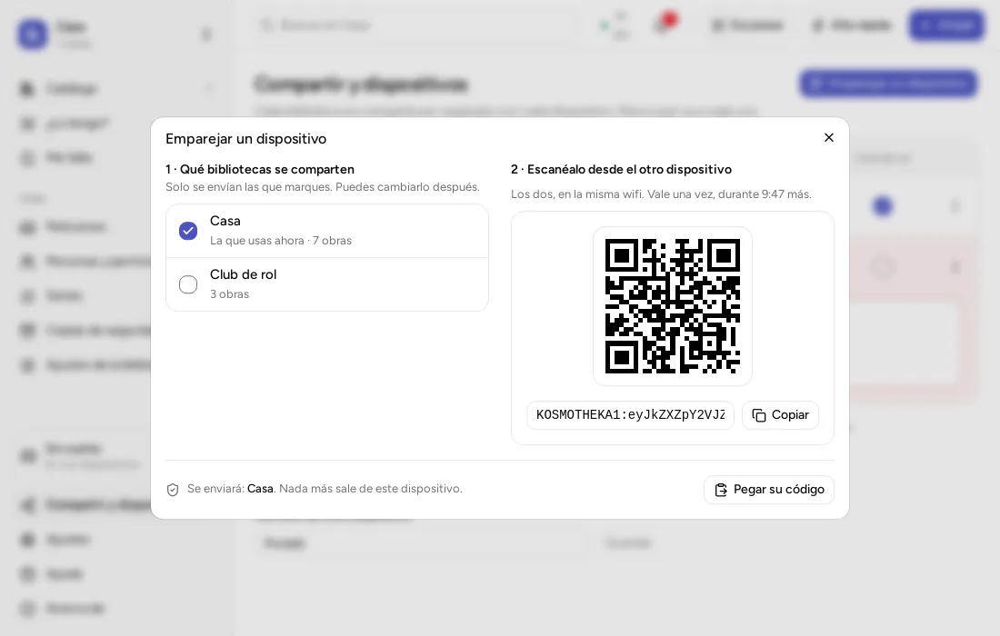
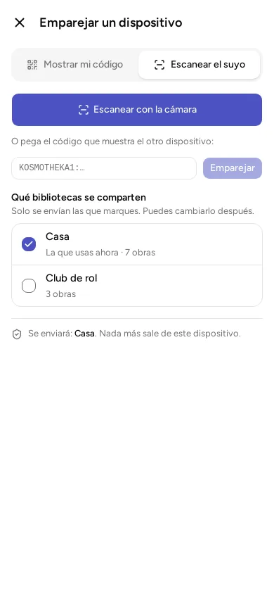

Puedes tener la misma biblioteca en varios dispositivos de casa: tu móvil, el de tu pareja, un portátil. Para eso hay que **emparejarlos**. Emparejar es conectar dos dispositivos para que se pasen los cambios.

Se hace una sola vez, con un código QR (el cuadrado de puntos que se lee con la cámara), por la wifi de casa. No hace falta cuenta ni internet, y los datos no pasan por ningún otro ordenador: van directos de un dispositivo a otro.

Cada dispositivo guarda la biblioteca entera. Cuando uno cambia algo, el otro lo recibe.

## Antes de empezar

- Los dos dispositivos tienen la app y la tienen abierta.
- Los dos están en **la misma wifi**, la de tu casa. No sirven los datos de la tarifa del móvil. Mejor no usar la wifi de invitados (la que se da a las visitas, con otra contraseña): en esa los dispositivos suelen no verse entre ellos.
- Si tienes instalado un programa de VPN o de privacidad que cambia tu conexión, apágalo mientras emparejas. Si no sabes qué es, no tienes que hacer nada.

## Emparejar dos dispositivos

Llama «A» al dispositivo que ya tiene la biblioteca y «B» al que la va a recibir.

**En A:**

1. Abre el menú (en el móvil, las tres rayitas de arriba a la izquierda) y entra en «Compartir y dispositivos».
2. Pulsa «Emparejar otro dispositivo». En el ordenador se llama «Emparejar un dispositivo».
3. Marca qué bibliotecas quieres compartir. Solo se envían las que marques.
4. Aparece un código QR. Debajo está el mismo código escrito con letras y números. Sirve una sola vez, durante 10 minutos. Si el otro dispositivo aún no tiene la app, toca «¿El otro dispositivo aún no tiene la app?»: en lugar del código de emparejar sale otro, que lleva a la página de descargas con su cámara. Cuando tenga la app, pulsa «Volver al código de emparejar».

**En B:**

1. Abre el mismo sitio: el menú, «Compartir y dispositivos» y el botón de emparejar.
2. Pulsa la opción «Escanear el suyo».
3. Pulsa «Escanear con la cámara» y pon la cámara delante del código de A.
4. Si B es un ordenador, no tiene cámara. En A pulsa «Copiar», junto al código. En B pulsa «Pegar su código», pega el código en el cuadro (como cuando copias y pegas un texto) y pulsa «Emparejar». En un móvil, ese cuadro está justo debajo del botón de la cámara.

Al terminar, B avisa con algo como «Emparejado con Móvil de Laura. Recibidos 12 cambios, enviados 3», y la biblioteca aparece en B. Un «cambio» es cada cosa que alguien ha añadido o modificado en la biblioteca. A avisa con «Emparejado con» y el nombre de B.

## Decir de quién es el dispositivo nuevo

Si tú administras la biblioteca (es decir, puedes cambiarlo todo en ella), la app te pregunta además «¿De quién es?» el dispositivo nuevo. Elige a una persona de la lista, o «Otra persona» y escribe su nombre. Lo que se haga desde ese dispositivo figurará como hecho por esa persona.

También eliges qué podrá hacer esa persona en cada biblioteca. Eso se llama su **rol**. Si no eliges otro, será editor.

- **Administrador:** puede hacerlo todo, también decidir quién entra y qué puede hacer cada uno.
- **Editor:** puede añadir y cambiar cosas, y borrar solo lo que ha añadido esa persona.
- **Lector:** puede ver la biblioteca y pedir los cambios que quiera, pero no hacerlos.

Quien administra puede cambiarlo todo, también añadir o quitar personas de la biblioteca. Da ese rol solo a quien quieras.

Si no administras la biblioteca, la app no te pregunta nada.

## Si la biblioteca está en la nube de otro servidor

Una biblioteca que te llega por QR puede estar subida a la nube de otro servidor, que no es la oficial de Kosmotheka. Al terminar el emparejamiento la app te lo dice: ««Club» está en una nube que no es la oficial de Kosmotheka: la lleva …». **Tu app no se conecta a ese servidor** por haber recibido la biblioteca: sigue hablando con el de tu cuenta, o con ninguno si no tienes cuenta, y la biblioteca se comparte contigo por la red de casa como cualquier otra. Solo si más tarde entras en una cuenta de ese servidor, tus datos irán allí; la app te avisará entonces también. La línea sigue viéndose en los ajustes de la biblioteca.

## Cómo se pasan los cambios después

Los dos dispositivos se actualizan solos cuando están en la misma wifi y la app está abierta. Pasa al abrir la app, al cambiar algo y, con la app en pantalla, cada cinco minutos: un cambio puede tardar hasta cinco minutos en llegar. Si uno está fuera de casa, se actualiza cuando vuelva.

**Las portadas también pasan**, justo después de los cambios y poco a poco: la obra aparece enseguida y su portada un momento más tarde. Es la misma imagen en todos los dispositivos, no se vuelve a buscar. La app guarda las portadas reducidas (unos 40 KB cada una), así que una biblioteca de cientos de obras pasa en segundos.

## Fuera de casa

Si estáis juntos pero sin wifi, activa en uno de los móviles la opción de compartir internet (la «zona wifi») y conecta el otro a esa red. Después, empareja o pasa los cambios como en casa. No gasta los datos de tu tarifa: todo va entre los dos dispositivos.

## Cambiar qué biblioteca va a cada dispositivo

En «Compartir y dispositivos» verás los dispositivos emparejados, con una casilla por biblioteca. Solo se envía lo marcado. Si desmarcas una, desaparece de ese dispositivo la próxima vez que se actualicen; en el tuyo no cambia nada.

También puedes pulsar «Dejar de compartir» en los «Ajustes de la biblioteca». Podrás volver a compartirla cuando quieras.

Con «Dejar de emparejar», en el menú de tres puntos de cada dispositivo, los dos dejan de estar emparejados. No se borra nada de tus bibliotecas: tus libros se quedan donde están. Para que vuelvan a pasarse los cambios, habrá que emparejarlos otra vez.

Si en una biblioteca no puedes compartir, la app te dice que se lo pidas a quien la administra.

## Si no se empareja

1. Comprueba que los dos están en la misma wifi y no usan los datos del móvil.
2. Mira que el código esté a la vista en A. Si han pasado más de 10 minutos, pulsa «El código ha caducado: generar otro».
3. Apaga la VPN, si usas una.
4. En Windows, si el antivirus o el programa de seguridad (el «cortafuegos») pregunta si deja entrar a la app, responde que sí.
5. Si el móvil pregunta si puede usar la «red local» (la wifi de casa) o los «dispositivos cercanos», acepta.
6. Si nada funciona, cierra la app en los dos y genera un código nuevo.

Algunos avisos concretos:

- «No se encuentra el otro dispositivo»: no están en la misma wifi, o la app está cerrada en el otro.
- «Los dos dispositivos tienen versiones distintas de la app»: actualiza los dos.
- «El otro dispositivo ya tiene emparejado este»: en el otro, usa primero «Dejar de emparejar» con este y vuelve a emparejar.

Si no se actualizan, no se pierde nada: lo harán solos en cuanto vuelvan a verse.
